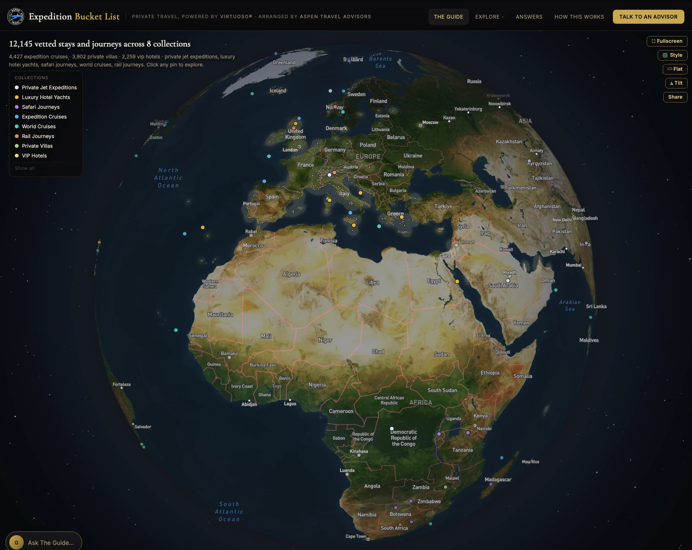

  

<h1 align="center">The Guide</h1>

  <em>Private travel, powered by Virtuoso® · Arranged by Aspen Travel Advisors</em>

  <a href="https://guide.expeditionbucketlist.com"><strong>Begin your journey at guide.expeditionbucketlist.com →</strong></a>

---

Some journeys are once in a lifetime. **The Guide** helps you find them.

Describe the trip you've been dreaming of, whether that's a private jet circling the
globe, a walking safari in Botswana, or a quiet villa above the Amalfi Coast. The
Guide answers with more than 12,000 hand-vetted stays and journeys, each one
shown on a living globe so you can see exactly where your next chapter unfolds.

## Eight ways to see the world

| | |
| --- | --- |
| ✈️ **Private Jet Expeditions** | Several continents in one seamless journey, with every connection handled for you |
| 🛥️ **Luxury Hotel Yachts** | Intimate sailings through the Mediterranean, the Caribbean and the South Pacific |
| 🦁 **Safari Journeys** | Lodges and camps across East and Southern Africa and beyond |
| 🧊 **Expedition Cruises** | Antarctica, the Arctic, the Galápagos and the world's wildest coastlines |
| 🌍 **World Cruises** | The grand voyage: months at sea and a world of ports |
| 🚂 **Rail Journeys** | The great trains, from Scottish sleepers to the Orient |
| 🏡 **Private Villas** | Exceptional homes with the space and privacy to match |
| 🏨 **VIP Hotels** | Virtuoso hotels with exclusive amenities for Guide travelers |

## How it works

1. **Ask The Guide.** Tell it where, when and what kind of experience you're after.
2. **Explore the Living Atlas.** Spin the globe, open any property or itinerary, and
   save favorites to your bucket list.
3. **Talk to an advisor.** When you're ready, The Guide passes your brief to an
   advisor at [Aspen Travel Advisors](https://aspentraveladvisors.com), who arranges
   every detail and books your trip.

## Why travel with Aspen Travel Advisors

As a **Virtuoso®** member agency, Aspen Travel Advisors brings travelers
the privileges of the world's leading luxury travel network: preferred rates,
amenities such as upgrades when available, daily breakfast and resort credits,
and an advisor who knows the places personally.

  <a href="https://guide.expeditionbucketlist.com"><strong>Visit The Guide</strong></a>
  &nbsp;·&nbsp;
  <a href="https://aspentraveladvisors.com"><strong>Aspen Travel Advisors</strong></a>

